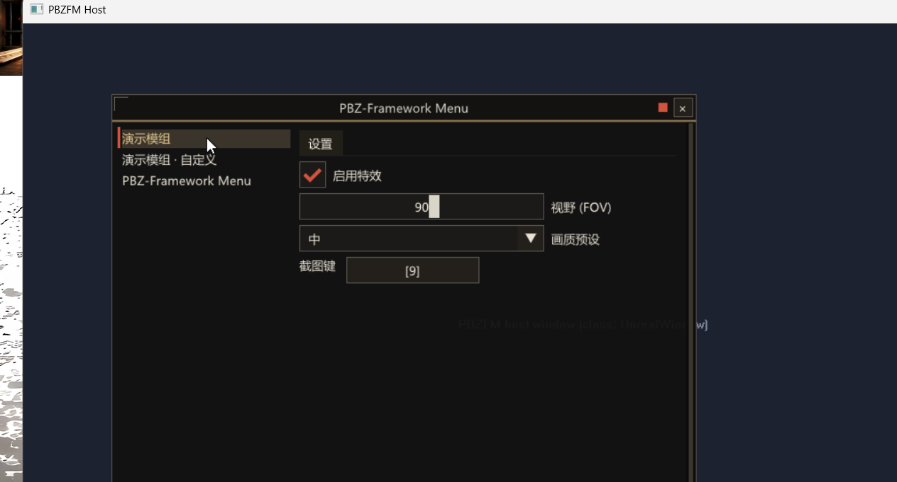

# PBZ-Framework Menu — 《影之刃零》模组菜单框架

类似 Skyrim 的 [SKSE Menu Framework 3](https://github.com/QTR-Modding/SKSE-Menu-Framework-3)
的《影之刃零》（Phantom Blade Zero, UE 5.7）模组菜单框架。目标：给
[PBZPhotoMode](https://github.com/lin-414/PBZPhotoMode) 这类 UE4SS C++ DLL 模组提供
**快捷键呼出的游戏内设置界面**、多语言、以及可由框架统一编辑的模组配置（含键位）。
模组如何注册自己的分区、设置页与热键，见《模组作者接入指南》。

当前状态：**0.5.0**。输入方案与截图直通（0.2.0/0.3.3）已实机验证，机制与实机铁律
详见 [docs/ARCHITECTURE.md](docs/ARCHITECTURE.md)；验证记录在
[docs/VERIFIED.md](docs/VERIFIED.md)。0.4.0 是面向模组作者的一版（SDK API 版本 2）：

- **ABI 兼容策略**：必需核心 + 可选导出。旧头文件配新框架继续工作，新功能在旧框架上
  退化为 NULL 指针（判空调用），导出名与签名一旦发布永不更改（[sdk/pbzfm.h](sdk/pbzfm.h)，
  API 版本 3）；
- **分类树与嵌套路径**（0.5.0）：侧边栏按模组树形展开（单页模组仍是单行，会话内记忆
  展开状态），模组用 `SetSectionPath` / `ConfigCreatePath` / `AddSectionItemPath` 以
  `"我的模组/冻结方式"` 式路径声明任意层级分类，点分类右侧只显示该分类；
- **菜单开关事件** \`OnMenuEvent\`（渲染线程，开/关各一次，免轮询）；
- **热键与键位升级**：\`AddHotkeyEx\`/\`RemoveHotkey\` 组合键热键（修饰键严格匹配），
  schema 新增组合键键位捕获（\`ConfigAddKeyCombo\`，存储 vk | mods<<8）；
- **分区生命周期**：\`RenameSection\` / \`DeleteSection\` / \`RemoveSectionItem\`；
- **纹理 API**：\`LoadTexture\` / \`Image\` / \`DisposeTexture\`（stb_image，渲染线程上传）；
- **Widget 扩充**：InputText / CollapsingHeader / Selectable / ProgressBar / ColorEdit3；
- **玩家侧**：侧边栏搜索框、主题 JSON（\`themes\<name>.json\` + 设置页选择器）；
- **工程化**：MIT LICENSE（SDK 头对客户端模组零义务）、THIRD_PARTY_NOTICES、DLL 版本
  资源（版本单一来源 CMakeLists）、CMakePresets/.clang-format、i18n 单测进 CTest。

手柄适配（XInput：长按选择键呼出/摇杆虚拟光标/XInputEnable 冻结）已开发完成并经
host 确定性回归，**应用户要求暂时搁置、未进正式包**——源码保留在 src/gamepad.*
（未编译，gamepad.h 头部有完整恢复步骤）。

## 架构

DirectComposition 独立覆盖窗 + 私有 D3D11 设备 + ImGui 1.92，完全不碰游戏的交换链
与 D3D 对象（FSR3 帧生成 / NVIDIA Streamline 安全）；输入靠低级钩子全吞 + 自绘光标 +
Raw Input 改指向，菜单期间镜头冻结、关闭即恢复。为什么是这条路线、以及全部实机铁律
（LL 钩子链插队、Raw Input 注册归属、ClipCursor/ShowCursor 禁区、截图直通两条路），
见 [docs/ARCHITECTURE.md](docs/ARCHITECTURE.md)。

## 构建

需要 VS 2022 BuildTools（C++ 工具集 + 自带 CMake/Ninja）。不依赖 RE-UE4SS 源码、
不需要 UEPseudo/Rust——原型 DLL 对 UE4SS 是零依赖的普通 DLL。

\`\`\`bat
build_all.bat            :: 构建（cmake + ninja），产物 build\PBZFM.dll + build\pbzfm_host.exe
tools\pack.ps1           :: 出 dist\PBZ-Framework-Menu_<版本>.zip（版本取自 CMakeLists，UE4SS 模组包）
ctest --test-dir build   :: i18n 单测（也可手动跑 build\i18n_test.exe）
\`\`\`

**部署约定**：本仓库的自动化只到"构建 + 打包 dist zip"为止——**不向游戏目录部署或复制
任何文件**。实机安装与测试由用户用模组管理器自行完成，测试结论反馈后录入
[docs/VERIFIED.md](docs/VERIFIED.md)。

## 游戏内安装（用户用模组管理器自行完成，自动化不碰游戏目录）

1. 安装 [UE4SS for PBZ](https://www.nexusmods.com/phantombladezero/mods/5)（KintaroModding fork）。
2. 用模组管理器（或手动解压）把 `dist/PBZ-Framework-Menu_0.5.0.zip` 装到
   `<游戏目录>\platform\steam\ue4ss\Mods\`，形成
   `ue4ss\Mods\PBZFM\{dlls\PBZFM.dll, enabled.txt, PBZFM.ini, languages\}`。
3. 启动游戏按 F8；验证清单见包内 README.txt。排障先看 `Documents\PBZ\Logs\PBZFM.log`
   （系统的“文档”目录，自动创建；该位置不可写时回落到 `ue4ss\Mods\PBZFM\PBZFM.log`）。

## 模组作者接入指南（C API / SDK）

零依赖接入头 [sdk/pbzfm.h](sdk/pbzfm.h)（随 dist zip 分发于 \`PBZFM/sdk/\`），唯一外部头
是 \`windows.h\`；所有函数运行时经 \`GetProcAddress\` 解析。完整指南（最小接入、线程契约、
两类页面、schema 控件、热键与组合键、分区生命周期、菜单事件、纹理、多语言、分发落点）
见 **[docs/MOD_AUTHORS.md](docs/MOD_AUTHORS.md)**；可编译参考
[host/demo_mod.cpp](host/demo_mod.cpp)。

## 许可证

MIT，见 [LICENSE](LICENSE)。**SDK 头（sdk/pbzfm.h）对客户端模组零义务**——只 include
该头与运行中的 PBZFM.dll 通信的模组不是本仓库的衍生作品，可用自己的任意许可证分发。
第三方依赖（ImGui、stb_image、stb_image_write）声明见
[THIRD_PARTY_NOTICES.md](THIRD_PARTY_NOTICES.md)。

## 目录

\`\`\`
src/            PBZFM.dll 源码（pbzfm 入口 / overlay DComp 渲染 / input 钩子 /
                gamepad XInput 手柄 / game_window 定位与子类化 / config / i18n / menu /
                theme（含 JSON 主题）/ textures / api+registry+schema 模组注册 C API）
sdk/            模组接入头文件 pbzfm.h（ABI v2：可选解析 + 兼容策略随头分发）
host/           测试宿主（模拟 UnrealWindow + 脚本输入 + 截图；demo_mod.cpp 为模组接入参考实现）
assets/         随包分发文件（PBZFM.ini、languages/*.json、README.txt）
tests/          i18n 单测（CTest）
tools/          pack.ps1（版本取自 CMakeLists）
cmake/          version.rc.in（DLL 版本资源模板）
third_party/    ImGui 1.92.1（vendored）、stb_image_write.h、stb_image.h
docs/           架构与实机铁律 / 接入指南 / 验证记录 / 自测截图
\`\`\`

## 下一阶段（按优先级）

1. **实机验证**：0.4.0 全部新功能待实机复核（清单见 docs/VERIFIED.md 底部表）；0.3.3
   遗留的前台判断 + 焦点回归重新抢占一并复核；剩余环境边角：真独占全屏/多显示器、HDR、
   Steam Overlay。
2. 手柄导航：开发完成（0.3.1 host 回归全绿）但**应用户要求暂时搁置、未进正式包**；
   源码保留在 src/gamepad.*（未编译，恢复步骤见 gamepad.h 头注）。剩余：游戏暂停
   （复用 PBZPhotoMode 已验证的暂停栈）。
3. 把 PBZPhotoMode 的 ImGui 诊断面板接成第一个客户端（其 MenuView/MenuActions 快照桥
   直接复用），顺带压测 SDK v2 的事件/纹理/生命周期路径。
4. 参考项目已验证可行的后续方向：每模组翻译文件（languages/<store>.json，模组自带
   翻译不必等框架发版）、自定义字体文件夹 + 字形范围开关、呼出键模式（双击/长按 +
   ConsumeToggleKey）、模组分组/归档/排序（0.5.0 已有分类树，模组组织仍开放）、
   AddWindow / AddHudElement（不暂停小窗与常驻 HUD 层）。
